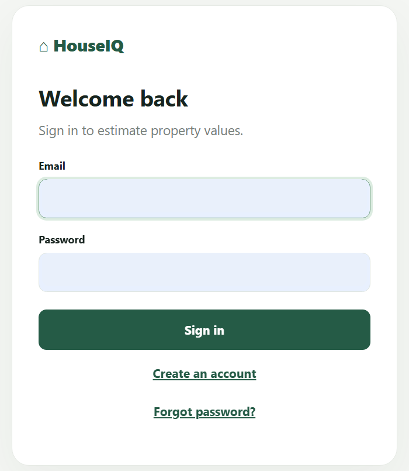
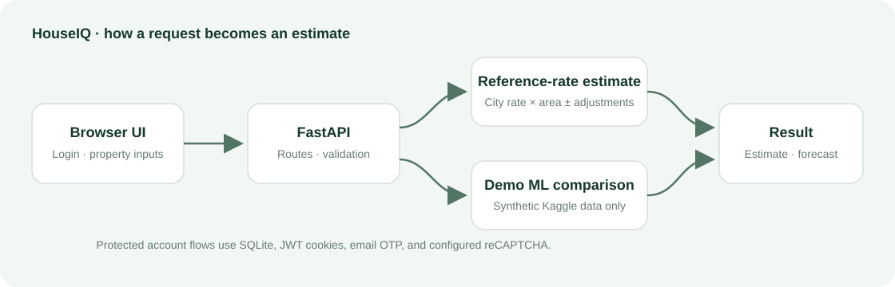

# HouseIQ

**An Indian property estimate and forecast web app built with FastAPI and scikit-learn.** HouseIQ estimates a home's current value from a sourced city reference rate where available, then shows an illustrative forecast from user supplied economic assumptions. A synthetic-data ML model is included as a comparison demo.

> **Demo limitations:** City reference rates are listing/reference prices, not registered sale prices. The ML training data is synthetic and its estimate is not comparable to real market prices. Forecasts are scenarios, not valuations or guarantees.

**Live demo:** [HouseIQ on Render](https://houseiq-1ttf.onrender.com/login) · **API docs:** [Swagger UI](https://houseiq-1ttf.onrender.com/docs)

## Screenshots

The login screenshot below has been cropped and its personal form entries removed. The dashboard is served by the same FastAPI app after sign in.



## What it does

- Estimates current property value with `city rate × area × small year/parking adjustments` when a city has a configured reference rate.
- Lets users edit the rate, shows its source and reporting period, and provides a non-blocking warning when an entered value is far outside a configured source band.
- Shows a **Locality spread range** only when the source provides low/high rates. Average-only source pages do not produce an invented range. Cities without a configured rate can still be estimated with a user-entered rate.
- Displays a separate **Demo ML estimate** for comparison. It uses a synthetic Kaggle dataset and is not the main estimate.
- Builds an assumptions-based future scenario (up to 50 years) from inflation, GDP growth, migration, and interest. It is not city-specific; long-run growth moves toward inflation.
- Provides account registration/sign-in, signed HttpOnly JWT session cookies, password reset by emailed one-time code, and Google reCAPTCHA Enterprise score checks when configured.
- Supports optional Google Sign-In through Google Identity Services; the backend verifies the Google ID token before linking or creating an account.
- Validates inputs in the browser and API, and exposes API docs through Swagger UI.

## Screens and request flow



The browser pages are `web/login.html` and `web/index.html`; FastAPI serves them at `/login` and `/app`. There is no separate frontend server to deploy.

## How estimates work

### Main estimate: sourced reference rate

The primary value is calculated from the configured typical rate and property size, then adjusted slightly for year built and parking. The rate table is in [`data/city_reference_rates.json`](data/city_reference_rates.json). Each sourced entry stores a link, reporting period, access date, and notes. Current configured rates are from MagicBricks: Jan–Mar 2026 for most entries, Oct–Dec 2025 for Kolkata, and Apr–Jun 2026 for Ahmedabad. These are asking/reference rates, not registered transactions.

There are 42 city choices; 34 have no configured source rate. Those cities are explicitly marked `not_set`. Users can enter their own rate to get a main estimate; HouseIQ does not scrape Google or fetch live prices. `average_only` entries show no locality range or out-of-range comparison warning because the source did not provide a clear low/high band.

### Demo ML estimate: comparison only

The saved scikit-learn model predicts INR per square foot from property attributes, and multiplies by area for the comparison value. It was trained from the [Indian House Price Prediction Dataset on Kaggle](https://www.kaggle.com/datasets/srisyra02/house-price-prediction-dataset), which describes its records as **synthetic**. The training pipeline cleans invalid/duplicate rows and reports held-out metrics; those metrics describe fit to the synthetic dataset only. The model is therefore useful for demonstrating data preparation, training, model persistence, and inference—not for claiming a real-market valuation.

### Future forecast

Forecast growth uses the supplied inflation, GDP growth, migration, and interest assumptions, with a bounded annual rate that gradually moves toward inflation over longer horizons. It is a general scenario, not a city-specific market forecast. Changing the forecast horizon does not change the current estimate.

## Tech stack

| Area | Tools |
|---|---|
| API and web server | Python, FastAPI, Uvicorn |
| Validation | Pydantic |
| ML and data | scikit-learn, pandas, joblib |
| Auth storage | SQLite |
| Auth security | scrypt password hashes, HMAC-signed HS256 JWT cookies, Google ID token verification (`google-auth`) |
| CAPTCHA and email | Google reCAPTCHA Enterprise assessments, SMTP OTP email |
| Tests | pytest, httpx |

## Project layout

```text
HouseIQ/
├── app/
│   ├── controllers/       # Prediction request handling
│   ├── repositories/      # Saved ML model loading
│   ├── routes/             # Prediction and authentication API routes
│   ├── schemas/            # Request validation
│   ├── services/           # Estimate, forecast, auth, and email logic
│   ├── utils/              # Logging and rate limiting
│   └── main.py             # FastAPI application and page routes
├── assets/screenshots/     # README images
├── data/                   # Training data and city-rate configuration
├── models/                 # Saved model, feature columns, metadata
├── scripts/train.py        # Model cleaning, training, and evaluation
├── tests/                  # API, validation, and authentication tests
├── web/                    # Login and estimate/forecast UI
├── requirements.txt
└── README.md
```

## Run locally (Windows PowerShell)

Open PowerShell in the project folder:

```powershell
python -m venv venv
.\venv\Scripts\Activate.ps1
python -m pip install -r requirements.txt
$env:AUTH_SECRET_KEY = (python -c "import secrets; print(secrets.token_urlsafe(48))")
python -m uvicorn app.main:app --reload
```

Open `http://127.0.0.1:8000/login`, create an account, and sign in. The estimate app is at `http://127.0.0.1:8000/app`; API documentation is at `http://127.0.0.1:8000/docs`.

For local development, CAPTCHA is disabled if all reCAPTCHA settings are omitted. To exercise password-reset email locally, configure SMTP environment variables in the same terminal before starting Uvicorn. Never put credentials in the README, source code, screenshots, or Git history.

## API endpoints

| Method | Path | Purpose |
|---|---|---|
| `GET` | `/health` | App/model health |
| `GET` | `/metadata` | Model and supported-input metadata |
| `GET` | `/city-rates` | City reference-rate configuration |
| `POST` | `/predict` | Current estimate |
| `POST` | `/predict/future` | Current estimate plus forecast |
| `POST` | `/auth/register` | Create account |
| `POST` | `/auth/login` | Sign in |
| `POST` | `/auth/google` | Verify Google ID token and sign in/link account |
| `POST` | `/auth/logout` | Sign out |
| `POST` | `/auth/forgot-password` | Request email OTP |
| `POST` | `/auth/verify-reset-otp` | Verify reset OTP |
| `POST` | `/auth/reset-password` | Save new password |

Prediction routes require a signed-in account. `/docs` provides interactive request schemas and responses.

## Deploy to Render

The app is a single FastAPI web service; deploy the repository root, not `web/` as a separate static site. Render's FastAPI guide uses `pip install -r requirements.txt` and a Uvicorn command bound to `0.0.0.0` and Render's `$PORT`. See [Render's FastAPI guide](https://render.com/docs/deploy-fastapi).

1. Push the project to GitHub and sign in at [Render](https://render.com/).
2. Choose **New → Web Service**, connect `Shlokverma0/HouseIQ`, select branch `main`, and choose the Python runtime.
3. Enter these commands:

   **Build:** `pip install -r requirements.txt`
   **Start:** `python -m uvicorn app.main:app --host 0.0.0.0 --port $PORT`

4. Add deployment environment variables in Render's **Environment** page, then deploy:

   | Variable | Value |
   |---|---|
   | `APP_ENV` | `production` |
   | `AUTH_SECRET_KEY` | A new random secret, at least 32 characters; generate one and keep it private |
   | `RECAPTCHA_SITE_KEY` | Your reCAPTCHA Enterprise website key (public site key) |
   | `RECAPTCHA_PROJECT_ID` | The Google Cloud project ID containing the key |
   | `RECAPTCHA_API_KEY` | A server-side API key restricted to reCAPTCHA Enterprise API; keep private |
   | `SMTP_HOST` | SMTP provider host |
   | `SMTP_PORT` | SMTP port allowed by your hosting plan/provider |
   | `SMTP_USERNAME` | SMTP username |
   | `SMTP_PASSWORD` | SMTP/app password; keep private |
   | `SMTP_FROM` | Verified sender address |
   | `HOUSEIQ_DEMO_EMAIL` | Optional demo account email; omit with its password to disable the demo account |
   | `HOUSEIQ_DEMO_PASSWORD` | Optional 10–128 character demo password; stored only as a password hash |
   | `GOOGLE_CLIENT_ID` | Optional Google OAuth 2.0 Web application client ID; no client secret is used |

   If both demo variables are set, startup creates that account without an email OTP (signup currently has no email-verification step). On later startups, only that configured account's password hash is synchronized if the configured password changed. Other users are not modified. The password is never logged. If either variable is missing or empty, no demo user is created and the app starts normally.

   Do not copy `.env` into the repository or paste secrets into GitHub. In Google reCAPTCHA settings, add the exact deployed `onrender.com` hostname to the key's allowed domains. After saving environment variables, redeploy and check Render logs and `/health`.

5. Open the generated `https://<service-name>.onrender.com/login`, create an account, then test the estimate screen, CAPTCHA, and API docs. Put the final URL in the Live Demo line at the top of this README and in your resume.

### Optional Google Sign-In setup

1. In Google Cloud Console, configure the **OAuth consent screen** and create an OAuth client with application type **Web application**.
2. Add these **Authorized JavaScript origins** (origins only; no URL path):
   - `http://localhost:8000`
   - `http://127.0.0.1:8000`
   - `https://houseiq-1ttf.onrender.com`
3. Set the generated Web application **Client ID** as `GOOGLE_CLIENT_ID` in the local environment or Render environment variables. Do not set a client secret; this GIS ID-token flow does not use one.
4. If the OAuth consent screen is in **Testing** mode, only accounts added under **Test users** can sign in. Publish/configure the consent screen as appropriate before allowing general users.

When `GOOGLE_CLIENT_ID` is empty or missing, the Google buttons stay hidden and password authentication works as usual. Google sign-in posts the ID token to `/auth/google`; the backend validates its signature, audience, issuer, expiry, and verified email before creating an account or linking the Google identity to the matching email account.

### Hosting notes for this app

Render Free services sleep after inactivity and use an ephemeral filesystem: the SQLite account database can be lost on restart, spin-down, or redeploy. The optional environment-configured demo account is recreated/synchronized at startup, but other accounts and their data can disappear. Free web services also block outbound SMTP ports 25, 465, and 587, so this app's current SMTP password-reset flow will not work on the free tier with those ports. See [Render's free-service limits](https://render.com/docs/free). For a durable public demo, use a persistent database (for example, migrate auth storage to managed Postgres) and an email delivery provider/plan supported by your host. The current code uses SQLite and direct SMTP; do not present those as production-durable until migrated and verified.

## Resume entry

After deployment succeeds, use a truthful entry such as:

> **HouseIQ — Indian Property Estimate & Forecast App** | Python, FastAPI, scikit-learn, SQLite
> Built a web app that estimates property values from sourced city reference rates, compares results with a synthetic-data ML model, and generates assumption-based forecasts. Implemented validated prediction APIs, account authentication, email OTP password reset, and CAPTCHA integration. **Live:** `<your deployed URL>` · **Code:** `https://github.com/Shlokverma0/HouseIQ`
